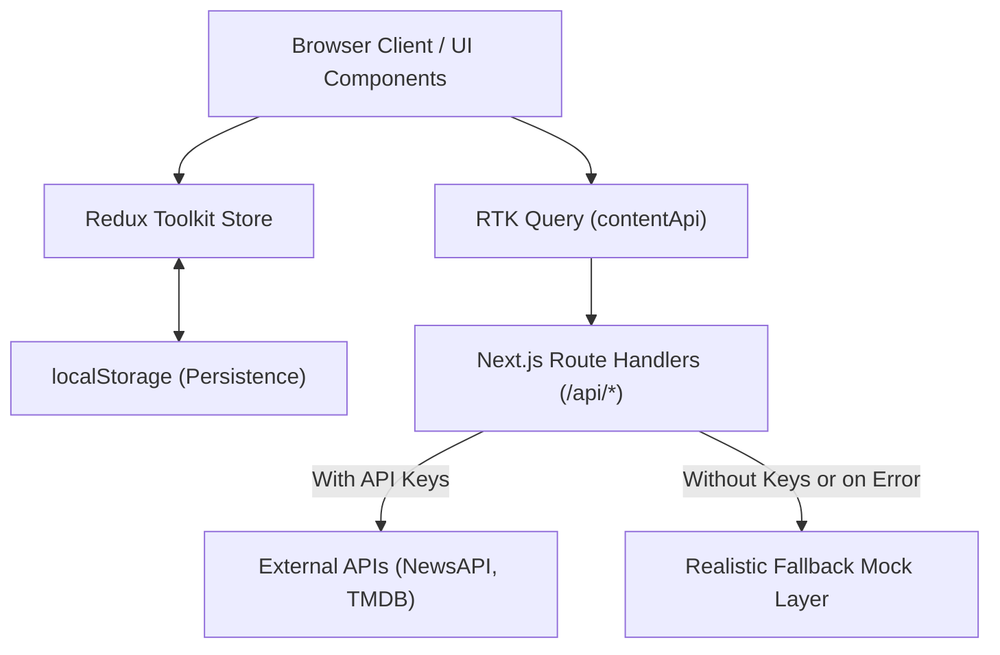

# Personalized Content Dashboard (NexusFeed PRO)

A modern, responsive, production-quality personalized content dashboard built with Next.js (App Router), React 19, TypeScript, Tailwind CSS v4, Redux Toolkit (RTK Query), Framer Motion, and dnd-kit.

Developed as a frontend engineering submission for the **SDE Intern – Frontend Development** role.

---

## 1. Overview

**NexusFeed PRO** is a personalized multi-source aggregation dashboard designed with modern SaaS design principles. It consolidates global breaking headlines (NewsAPI), cinema releases & ratings (TMDB), and developer discussions into a single drag-and-drop feed with offline persistence and debounced search.

The application is built to be resilient: external APIs are proxied via Next.js Route Handlers to protect API keys server-side and eliminate client-side CORS issues. When external credentials are unavailable or rate-limited, the application seamlessly runs in a high-fidelity demo mode with 100% operational UI and zero crashes.

---

## 2. Key Features

- **Personalized Multi-Source Feed**:
  - Unified stream combining News articles, Movies, and Social posts.
  - Interactive topic filters: *Technology, Sports, Business & Finance, Entertainment, Science, Health & Wellness*.
  - Polymorphic card rendering tailored for each content type (`NewsCard`, `MovieCard`, `SocialCard`).
  - Interactive preview modal with full article links, ratings, discussion comments, and share actions.

- **Drag-and-Drop Feed Customization (`dnd-kit`)**:
  - Reorder feed cards via dedicated grip handles with collision detection and smooth drag overlays.
  - Touch-friendly sensor thresholds (8px activation distance) preventing accidental drags during mobile scrolling.
  - Custom sequence automatically persisted to `localStorage` and Redux store.
  - One-click "Reset Order" action to restore default chronological order.

- **Persistent Favorites**:
  - One-click heart micro-animation on any card across the dashboard.
  - Dedicated `/favorites` page with category filtering and instant in-memory search.
  - Persistent state in `localStorage` surviving browser reloads.
  - Individual item removal and confirmation-backed "Clear All" action.

- **Debounced Global Search**:
  - Custom `useDebounce` hook (400ms delay) preventing duplicate or unnecessary API calls.
  - Categorized tabbed results: *All, News, Movies, Social*.
  - Interactive suggestions chips (*#quantum, #dune, #marathon, #fintech, #astronomy*).
  - Clean LoadingSkeleton, ErrorState with retry, and EmptyState components.

- **Dark & Light Mode**:
  - System-wide Tailwind CSS dark mode variant with smooth CSS color transitions.
  - Theme toggler in the global header (Dark, Light, System sync).
  - Complete zero-flash synchronization on page load via `StoreProvider`.

- **Trending Carousel Section**:
  - Dedicated `/trending` view and dashboard carousel modules.
  - Smooth horizontal scrolling with snap points and navigation controls.
  - Dynamic score calculations based on engagement metrics and ratings.

- **Comprehensive Settings & User Persona**:
  - Dynamic time-of-day greeting (*"Good morning / Good evening, Vamshi"*).
  - Multi-select category preference checkboxes.
  - Live API status monitor and reset-to-defaults functionality.

---

## 3. Tech Stack

| Category | Technology |
|---|---|
| **Framework** | [Next.js](https://nextjs.org/) (App Router, Server Route Handlers) |
| **UI Library** | [React 19](https://react.dev/) |
| **Language** | [TypeScript 5](https://www.typescriptlang.org/) (Strict typing, no `any`) |
| **Styling** | [Tailwind CSS v4](https://tailwindcss.com/) with custom `@custom-variant dark` |
| **State Management** | [Redux Toolkit](https://redux-toolkit.js.org/) (`@reduxjs/toolkit`, `react-redux`) |
| **Data Fetching / Cache** | [RTK Query](https://redux-toolkit.js.org/rtk-query/overview) (`createApi`, tag invalidation) |
| **Animations** | [Framer Motion](https://www.framer.com/motion/) |
| **Drag & Drop** | [dnd-kit](https://dndkit.com/) (`@dnd-kit/core`, `@dnd-kit/sortable`, `@dnd-kit/utilities`) |
| **Icons** | [Lucide React](https://lucide.dev/) |
| **Unit & Integration Tests** | [Vitest](https://vitest.dev/), [React Testing Library](https://testing-library.com/), [jsdom](https://github.com/jsdom/jsdom) |
| **E2E Testing** | [Playwright](https://playwright.dev/) |
| **Persistence** | `localStorage` API |

---

## 4. Architecture



### Architectural Highlights:
1. **Server Route Proxying**: External API keys (`NEWS_API_KEY`, `TMDB_API_KEY`) remain strictly on the server in Next.js Route Handlers (`/api/news`, `/api/movies`), never leaking to client-side bundles.
2. **CORS & Rate-Limit Resilience**: NewsAPI's free plan restricts browser-origin requests. Next.js server routes bypass CORS issues and intercept rate-limit failures, gracefully falling back to realistic mock datasets.
3. **Optimistic Local Storage Integration**: Redux slices (`preferencesSlice`, `favoritesSlice`, `feedOrderSlice`) read and write `localStorage` synchronously while providing type-safe Redux state across all React tree components.
4. **Polymorphic Content Model**: News, Movies, and Social posts are normalized into a unified `ContentItem` interface through pure mapper functions in `src/lib/transformers.ts`.

---

## 5. Project Structure

```text
├── e2e/
│   └── dashboard.spec.ts           # Playwright E2E test suite (7 flows)
├── public/
├── src/
│   ├── app/
│   │   ├── api/
│   │   │   ├── movies/route.ts     # TMDB proxy & search route handler
│   │   │   ├── news/route.ts       # NewsAPI proxy route handler
│   │   │   └── social/route.ts     # Mock social feed route handler
│   │   ├── favorites/page.tsx      # Favorites management view
│   │   ├── feed/page.tsx           # Personalized feed view
│   │   ├── search/page.tsx         # Debounced global search view
│   │   ├── settings/page.tsx       # User preferences & theme settings
│   │   ├── trending/page.tsx       # Trending carousels view
│   │   ├── globals.css             # Tailwind v4 theme tokens & styles
│   │   ├── layout.tsx              # Root HTML layout with providers & SEO
│   │   └── page.tsx                # Main Dashboard home view
│   ├── components/
│   │   ├── cards/
│   │   │   ├── ContentCard.tsx     # Master polymorphic card dispatcher
│   │   │   ├── MovieCard.tsx       # TMDB cinema card component
│   │   │   ├── NewsCard.tsx        # News headline card component
│   │   │   └── SocialCard.tsx      # Social post card component
│   │   ├── common/
│   │   │   ├── ContentModal.tsx    # Interactive story/details modal
│   │   │   ├── EmptyState.tsx      # Reusable empty state with CTA
│   │   │   ├── ErrorState.tsx      # Reusable error card with retry
│   │   │   ├── FavoriteButton.tsx  # Animated heart micro-interaction
│   │   │   └── LoadingSkeleton.tsx # Multi-variant pulse skeleton
│   │   ├── dashboard/
│   │   │   └── WelcomeBanner.tsx   # Dynamic time-of-day greeting card
│   │   ├── feed/
│   │   │   └── DragDropFeed.tsx    # dnd-kit sortable grid container
│   │   ├── layout/
│   │   │   ├── AppShell.tsx        # Responsive layout wrapper
│   │   │   ├── Header.tsx          # App header with search, theme, profile
│   │   │   └── Sidebar.tsx         # Desktop sidebar & mobile navigation
│   │   ├── providers/
│   │   │   └── StoreProvider.tsx   # Redux + Theme synchronization provider
│   │   └── trending/
│   │       └── TrendingCarousel.tsx# Horizontal scroll carousel
│   ├── data/
│   │   └── mockData.ts             # Realistic data layer across 6 categories
│   ├── hooks/
│   │   ├── useDebounce.ts          # Generic 400ms debouncing hook
│   │   └── useTheme.ts             # Light/dark theme toggling hook
│   ├── lib/
│   │   └── transformers.ts         # Domain-to-ContentItem mappers & formatters
│   ├── store/
│   │   ├── services/
│   │   │   └── contentApi.ts       # RTK Query API slice with caching
│   │   ├── slices/
│   │   │   ├── favoritesSlice.ts   # Persistent favorites Redux slice
│   │   │   ├── feedOrderSlice.ts   # Persistent dnd-kit order Redux slice
│   │   │   └── preferencesSlice.ts # Persistent categories & theme slice
│   │   └── index.ts                # Redux store configuration & typed hooks
│   ├── tests/
│   │   ├── setup.ts                # Vitest jsdom & matchMedia mocks
│   │   ├── ContentCard.test.tsx    # Card rendering & favorite toggle test
│   │   ├── FavoritesPage.test.tsx  # Favorites view integration test
│   │   ├── favoritesSlice.test.ts  # Favorites reducer unit test
│   │   ├── feedOrderSlice.test.ts  # Card ordering reducer unit test
│   │   ├── preferencesSlice.test.ts# Preferences reducer unit test
│   │   ├── transformers.test.ts    # Transformer utility unit test
│   │   └── useDebounce.test.ts     # Hook debounce timing unit test
│   └── types/
│       └── content.ts              # TypeScript interfaces & types
├── .env.example                    # Environment variable template
├── .gitignore
├── next.config.ts                  # Remote image domain configurations
├── package.json                    # Scripts and dependencies
├── playwright.config.ts            # E2E test configuration
├── tsconfig.json                   # TypeScript configuration
└── vitest.config.mts               # Vitest runner configuration
```

---

## 6. Environment Variables

Create a `.env.local` file in the project root:

```bash
cp .env.example .env.local
```

Populate the keys:

```ini
# NewsAPI Key (free at https://newsapi.org/)
NEWS_API_KEY=your_news_api_key_here

# TMDB API Key (free at https://www.themoviedb.org/settings/api)
TMDB_API_KEY=your_tmdb_api_key_here

# Base URL (default is http://localhost:3000)
NEXT_PUBLIC_APP_URL=http://localhost:3000
```

> **Note on Demo Mode**: If neither key is provided, the application automatically enters **High-Fidelity Demo Mode**. All categories, searching, favoriting, drag-and-drop, and interactions operate seamlessly using realistic verified mock streams.

---

## 7. Installation & Running Locally

### Prerequisites
- Node.js 18.18+ or 20+ (tested on Node v22.17.1)
- npm 9+ or 10+

### Step 1: Clone & Install Dependencies
```bash
npm install
```

### Step 2: Start Development Server
```bash
npm run dev
```

Open [http://localhost:3000](http://localhost:3000) in your browser.

---

## 8. Testing

### Run Unit & Integration Tests (Vitest)
```bash
npm test
```
All 7 test suites (31 tests) execute in isolated jsdom environments with 100% pass rate.

### Run Tests in Watch Mode
```bash
npm run test:watch
```

### Run Playwright E2E Tests
```bash
npm run test:e2e
```
Playwright verifies all 7 critical user flows:
1. Opening Dashboard homepage & greeting
2. Changing user persona & category preferences
3. Executing debounced global search
4. Favoriting content
5. Viewing and managing favorites
6. Reordering feed cards with drag-and-drop
7. Switching theme between Dark and Light mode

---

## 9. Production Build

To test the optimized production build:

```bash
npm run build
npm start
```

---

## 10. Deployment (Vercel)

This project is optimized for deployment on [Vercel](https://vercel.com):

1. Push your repository to GitHub.
2. In Vercel, click **"Add New Project"** and import the repository.
3. Configure Environment Variables in the project settings (`NEWS_API_KEY`, `TMDB_API_KEY`).
4. Click **Deploy**. Vercel will detect Next.js App Router and deploy both static pages and API proxy route handlers globally.

---

## 11. User Flow

```
[ Dashboard (/) ]
      │
      ├──> [ View Welcome Banner & Dynamic Topics ]
      ├──> [ Explore Trending Highlights (Carousels) ]
      ├──> [ Drag & Drop Reorder Cards ] ──> Persists in localStorage
      ├──> [ Click Heart on Card ] ─────────> Saves to Favorites
      │
      ├──> [ Header Search Bar ] ───────────> 400ms Debounce ──> [ /search?q=... ]
      ├──> [ Theme Toggle (Sun/Moon) ] ─────> Instant Dark/Light CSS Switch
      │
      ├──> Sidebar: [ /feed ] ──────────────> Topic Filter Chips & Drag Reorder
      ├──> Sidebar: [ /trending ] ──────────> Full Carousels & Category Grids
      ├──> Sidebar: [ /favorites ] ─────────> Filter & Remove Saved Content
      └──> Sidebar: [ /settings ] ──────────> Update Persona, Topics, and Theme
```

---

## 12. Future Improvements

1. **User Authentication**: Implement NextAuth.js / Supabase Auth to sync favorites and preferences across multiple devices.
2. **Infinite Virtualized Feed**: Add `@tanstack/react-virtual` for endless scrolling of thousands of news items.
3. **Custom RSS Ingestion**: Allow users to paste custom RSS/Atom feed URLs directly into their personal stream.
